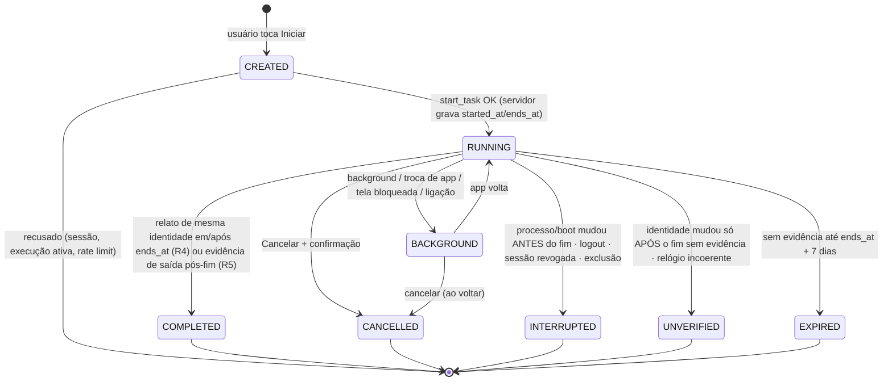
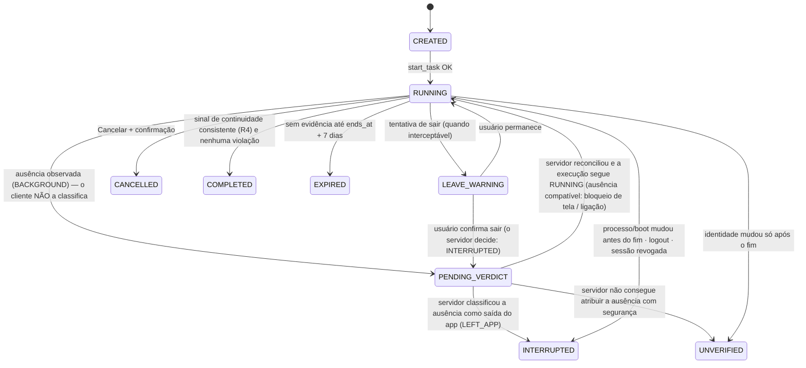

# Private Points — Timers V1

> **Revisão 3.** Incorpora D15–D25 (relógio monotônico rebaixado a medida local; `UNVERIFIED` imutável; contrato cliente→servidor). Legenda de confiança em [architecture.md](architecture.md). Regras de negócio: spec (seções 18–33, 63–65) e decisões D01, D02, D08, D09, D11, D12, D15–D22. SQL de referência em [database.md](database.md) (§0005).

## 1. Princípios

1. **Nunca `setInterval` como fonte de verdade.** O tempo restante é função pura de `ends_at` (do servidor), de uma amostra de calibração e do relógio monotônico local (§1.1). O tick de UI (~1 Hz) só redesenha.
2. **Autoridade temporal = `server_now` / relógio do Postgres.** `started_at`, `ends_at`, `reconcile_until` e o `received_at` de cada sinal são gravados pelo servidor. O relógio de parede do aparelho **não é autoridade** e não entra em nenhuma decisão.
3. **O cliente nunca é autoridade para conceder Points (D20).** Ele envia **sinais**; o servidor os grava com o **seu** `received_at` e **reconcilia** a execução por regras determinísticas (§7). O servidor **pode** concluir e recompensar sozinho quando a evidência server-side for suficiente; **nenhum evento isolado** do cliente fabrica uma conclusão.
4. **Timer Normal funciona em background (D21).** Nenhuma regra exige o app em primeiro plano para a recompensa ser válida.
5. **Dois comportamentos, duas máquinas** (D12). Comum: relógio, sincronização, ingestão de sinais, reconciliação, ledger. Diferente: tabela de transições e interpretação dos sinais.
6. **Conservadorismo:** quando a plataforma não dá certeza, **não há Points** (D11, D16).

### 1.1 Relógios, calibração e o que o monotônico NÃO faz (D24)

| Relógio | Autoridade? | Uso permitido |
|---|---|---|
| `server_now` / `clock_timestamp()` do Postgres | **Sim** — única | `started_at`, `ends_at`, `received_at`, `reconcile_until`, toda decisão de recompensa |
| Relógio de **parede** do aparelho (`Date.now()`, hora do sistema) | **Não** | nenhum uso em decisão. (O `process_exit.at` do Android é relógio de parede: é só telemetria) |
| Relógio **monotônico** do aparelho (Android `elapsedRealtime`, iOS relógio contínuo — ambos incluem o tempo de suspensão) | **Não** | medir **tempo decorrido local**: UI do tempo restante, agendar o envio do sinal de fim e ordenar/atribuir eventos relativamente ao início local |

O monotônico **não está na mesma escala** de nenhum timestamp absoluto do servidor e **nunca é comparado diretamente** com um. A única ponte é uma **amostra de calibração** (estilo NTP), implementada em `domain/timers/shared/clock.ts`:

```text
m0 = monotônico imediatamente ANTES de enviar a requisição
m1 = monotônico imediatamente DEPOIS de receber a resposta
s  = server_now devolvido na resposta (lido pelo servidor entre m0 e m1)

mSync       = m0 + (m1 − m0) / 2            # assume que s foi lido no meio do RTT
incerteza0  = (m1 − m0) / 2                 # metade do RTT
incerteza(m)= incerteza0 + (m − mSync) · driftPpm / 1e6        # deriva do oscilador

serverNowEstimado(m) = s + (m − mSync)
restante(m)          = max(0, ends_at − serverNowEstimado(m))
atrasoSinalFim(m)    = max(0, (ends_at − serverNowEstimado(m)) + incerteza(m) + margem)
```

Tolerâncias documentadas (constantes em `CLOCK_TOLERANCES`): `driftPpm = 100` (8,64 s/dia), `signalSendMarginMs = 2 s`; entre várias amostras escolhe-se a de **menor incerteza efetiva**.

> **Semântica (importante):** a calibração de relógio é uma **estimativa operacional de correlação temporal, não uma prova de que o cliente é honesto**. Mesmo com calibração perfeita, um cliente comprometido pode forjar sinais; a segurança da recompensa **não depende da fórmula de clock** (ela só afeta o que a UI mostra e *quando* o sinal é enviado).
>
> **A margem de 2 s é técnica/operacional (envio do sinal), não regra de negócio.** Ela **não** é uma “tolerância de conclusão” concedida ao usuário: o servidor compara `received_at ≥ ends_at` de forma **estrita, sem folga** (nenhum `+ margem` em SQL). Se o sinal chegar antes de `ends_at` (estimativa otimista), a resposta é `RUNNING` e o cliente tenta de novo; ninguém ganha segundos. O erro da UI é, portanto, ≈ RTT/2 + deriva; ele só afeta o que aparece na tela e *quando* o sinal de fim é enviado.

**O que o servidor NÃO faz:** não compara `Δmonotônico_cliente` com `Δtempo_servidor` para validar ou invalidar uma conclusão. Avaliado com honestidade: essa comparação **não acrescenta segurança** — um cliente hostil escolhe o valor de monotônico que quiser, e as falhas honestas (reinício, processo novo) já são pegas por `boot_id` e `process_instance_id`. Mantê-la criaria falsa sensação de segurança **e** falsos positivos (eventos enviados em lote/atrasados, latência de rede diferente entre início e fim). Por isso a regra `CLOCK_INCOHERENT` da revisão 2 foi **removida** (simplificação deliberada).

**Manipulação do relógio de parede não fabrica conclusão válida**, porque a decisão usa apenas: (1) `received_at ≥ ends_at` no relógio do servidor, (2) identidade de processo/boot, (3) ausência de violações. Nada disso depende da hora do aparelho. O que o usuário consegue mudando a hora é alterar o que *vê* no app; o servidor ignora.

**Único uso do monotônico na decisão (R1/R3, Foco):** situar um evento de ausência *antes ou depois do fim* usando `min(decorrido_local, decorrido_do_servidor_até_o_recebimento)` (`private.event_elapsed_ms`): um evento não pode ter ocorrido depois de recebido. Continua sendo sinal do cliente: um cliente hostil pode **omitir** eventos; isso é risco residual documentado (security.md §9), não algo que o monotônico resolva.

### 1.2 Contrato cliente → servidor

O cliente envia **apenas** `p_execution_id` e uma lista de eventos **brutos** com `event_type`, `client_mono_ms`, `process_instance_id`, `boot_id` e `process_exit?` (telemetria). **Não existe campo de causa/classificação** (`cause`, `reason`, `kind`, `source`, `type` de decisão…): o cliente informa *o que observou* (ex.: `BACKGROUND`, `SCREEN_LOCKED`, `CALL_STARTED`), e o **servidor** correlaciona os sinais e decide se a circunstância é compatível com uma execução válida (§6). **Nunca** envia `completed`, `reward`, quantidade de Points, `state`, `end_reason`, `ends_at` ou `server_now`. Isso é imposto em três camadas: tipos/`toWireEvent` no cliente (`signals.ts`, com teste), lista branca **estrita** de chaves em `private.ingest_events` (chave desconhecida ⇒ erro) e ausência de qualquer parâmetro de conclusão nas RPCs. A recompensa continua sendo exclusivamente `reconcile_execution → credit_execution`, idempotente e atômica.

## 2. Estados e resultados — sem mistura (D22)

O servidor persiste **um** destes estados em `task_executions.state`, cada um com motivos próprios (`state_reason_map` no banco impede combinações inválidas):

| Estado | Definição | Terminal | Points | Motivos (`end_reason`) | Quando ocorre |
|---|---|---|---|---|---|
| `RUNNING` | Em andamento **ou** vencida e ainda aguardando evidência dentro dos 7 dias | não | — | — | início até decisão |
| `COMPLETED` | O servidor **aceitou a evidência disponível como suficiente, segundo as regras da V1**, para creditar a execução (ver 2.2); crédito lançado | sim | **sim (1×)** | `COMPLETED` | regra R4 |
| `CANCELLED` | O usuário cancelou (com confirmação) | sim | não | `USER_CANCELLED` | ação explícita |
| `INTERRUPTED` | A evidência recebida **indica violação** de uma regra de interrupção (o servidor aplicou a regra; não é prova contra cliente comprometido) | sim | não | `PROCESS_TERMINATED`, `DEVICE_REBOOT`, `FOCUS_LEFT_APP`, `FOCUS_LEAVE_CONFIRMED`, `SESSION_REVOKED`, `LOGOUT`, `ACCOUNT_DELETED` | R1, R2, logout, revogação, exclusão |
| `UNVERIFIED` | A duração transcorreu, mas a **a evidência não permitiu aceitar nem recusar a continuidade** — **continuidade não verificável**. **Terminal e imutável** | sim | **não** | `CONTINUITY_UNVERIFIABLE`, `FOCUS_ABSENCE_UNATTRIBUTED` | R3, R5 |
| `EXPIRED` | Nenhuma evidência chegou até `reconcile_until` (fim + **7 dias**); higiene | sim | **nunca** | `STALE_EXPIRED` | R6 |
| `FAILED` | Falha técnica do servidor impede decidir (raro; auditado como `SECURITY_EVENT`) | sim | não | `SERVER_FAILURE` | erro interno |

**Como distinguir na prática**

| Pergunta | Resposta |
|---|---|
| "Sei que o usuário violou a regra?" | `INTERRUPTED` |
| "Não sei se violou nem se cumpriu, e a plataforma não me permite saber?" | `UNVERIFIED` |
| "Ele escolheu parar?" | `CANCELLED` |
| "Ninguém apareceu em 7 dias?" | `EXPIRED` |
| "O servidor quebrou?" | `FAILED` |
| "Cumpriu e provou?" | `COMPLETED` |

### 2.1 `UNVERIFIED` nunca vira `COMPLETED` (D23)

`UNVERIFIED` é **terminal**. Uma nova requisição do cliente — heartbeat, `sync`, `reconcile_task`, retry, replay — **não** o altera: `reconcile_execution` retorna cedo para estados terminais, o trigger `task_execution_guard` rejeita qualquer `UPDATE` fora de `RUNNING`, `credit_execution` só atua em `RUNNING` e o ledger admite uma recompensa por execução. No cliente, as duas máquinas lançam erro para `UNVERIFIED → (qualquer outro)` (testado exaustivamente em `immutability.test.ts`).

**Reconciliação posterior legítima?** Na V1 **não existe**: `UNVERIFIED` é exatamente o caso em que não há evidência server-side que a sustentasse. Se no futuro existir (p.ex. atestação de integridade do app verificada no servidor), a transição será **explícita** e **server-side**: migration própria com regra determinística, motivo novo (`end_reason`), auditoria e testes; jamais por vontade do cliente. Sem evidência suficiente, `UNVERIFIED` permanece sem recompensa.

### 2.2 O que `COMPLETED` significa na V1

> `COMPLETED` na V1 significa: **o servidor aceitou a evidência disponível como suficiente, segundo as regras da V1, para creditar aquela execução.**

**Não** significa que o servidor provou criptograficamente que o usuário permaneceu fisicamente no Modo Foco (nem que estudou) durante todo o período. `process_instance_id`, `boot_id`, o relógio monotônico e o beacon são **sinais de continuidade e consistência**: detectam reinício, processo novo e inconsistência em cenários honestos ou acidentais; **não** são provas contra um cliente comprometido, que pode forjá-los.

`EXPIRED` **não é janela de resgate** (D15): não existe prazo de minutos para abrir o app. É o horizonte em que a execução ainda pode ser reconciliada; passado esse prazo sem conclusão válida, nunca gera Points.

**Fases do cliente** (não persistidas como estado; viram eventos brutos): `CREATED` (transitório), `FOREGROUND`, `BACKGROUND`, `LEAVE_WARNING` (Foco) e `PENDING_VERDICT` (Foco: ausência reportada, aguardando o servidor). O cliente **não** tem fases do tipo "tela bloqueada tolerada" ou "ligação tolerada": tolerar é decisão do servidor.

## 3. Máquina do Timer Normal (Estudo — 30 min — 100 Points)



| Sinal | Efeito no Normal |
|---|---|
| Home / trocar de app / outro app em uso | continua |
| Tela bloqueada | continua |
| Ligação | continua |
| **Encerramento efetivo do app** | perde (`INTERRUPTED` se a evidência recebida indicar antes do fim; `UNVERIFIED` se só se descobre depois do fim sem evidência — §7/§8) |
| Desligar/reiniciar aparelho | perde (`INTERRUPTED` `DEVICE_REBOOT` se antes do fim; `UNVERIFIED` se só depois) |
| Cancelar (com confirmação) | `CANCELLED`, sem Points, auditado |
| Logout / sessão revogada / exclusão | `INTERRUPTED` |

**Sem exigência de primeiro plano (D21):** se o tempo acabar com o app em background, a execução continua elegível. No **Android**, o *beacon* do foreground service reporta logo após `ends_at` e o servidor credita sem interação. No **iOS**, o app fica suspenso (não executa código em `ends_at`); a continuidade é provada quando **o mesmo processo** volta a reportar, em qualquer momento até 7 dias depois.

## 4. Máquina do Modo Foco (Estudo - Modo Foco — 30 min — 200 Points)



Diferenças de negócio frente ao Normal:

- **Sem navegação normal** (sem botão voltar); gestos de saída disparam o aviso "o Modo Foco será encerrado, o progresso será perdido e nenhum Point será recebido".
- **Tela apagada/bloqueada é permitida** — **sem** exigir passcode em nenhuma plataforma (D16).
- **Home/troca voluntária:** o **servidor** classifica (§6): `INTERRUPTED` quando a plataforma tem os dois canais de observação e nenhum registrou bloqueio/ligação; quando algum canal não existe e a ausência não pode ser atribuída com segurança, o resultado é **`UNVERIFIED` (sem Points)** — conservador e documentado. O cliente não envia causa.
- **Ligação (D01):** não invalida sozinha, não conclui nem recompensa. Ao voltar, vale a reconciliação normal (mesma identidade? tempo coerente?).
- **Notificações:** §9.

## 5. Sinais que o módulo nativo (`pp-platform`) emite

| Sinal tipado (`event_type`) | Uso |
|---|---|
| `HEARTBEAT` (identidade + monotônico local) | **sinal** de continuidade quando **recebido** pelo servidor em/após `ends_at` (regra R4); o monotônico não é comparado ao servidor |
| `APP_LAUNCH` / `FOREGROUND` / `BACKGROUND` | observação bruta de lifecycle |
| `SCREEN_LOCKED` / `SCREEN_UNLOCKED` | observação bruta; o **servidor** a usa como corroboração de uma ausência |
| `CALL_STARTED` / `CALL_ENDED` | observação bruta; idem |
| `CHANNEL_SCREEN_OBSERVABLE` / `CHANNEL_CALL_OBSERVABLE` | observação bruta de **capacidade**: "este aparelho consegue observar bloqueio de tela / estado de ligação" |
| `LEAVE_ATTEMPT` / `LEAVE_CONFIRMED` / `LEAVE_CANCELLED` | aviso de saída (Foco) |
| `process_exit{at,kind}` (Android, em `details`) | **telemetria apenas** (relógio de parede do aparelho); não decide estado nem crédito |

Toda mensagem carrega `process_instance_id` (UUID por processo, em memória), `boot_id` e `client_mono_ms`. O adaptador nativo **não decide validade**; emite sinais. O servidor rejeita tipos reservados ao servidor (`STARTED`) e limita o lote (≤ 200).

## 6. Ausências no Modo Foco — o servidor classifica (D26)

**O cliente não classifica. Ele observa e reporta; o servidor decide.** Não existe `cause`, `reason`, `kind` nem `type` de decisão no payload. Para cada `BACKGROUND` anterior ao fim, `private.absence_verdict` (SQL; modelo executável em `domain/timers/reference/absence.ts`) procura corroboração nos **outros sinais brutos**:

| Sinais brutos recebidos | Classificação feita pelo servidor | Resultado |
|---|---|---|
| `BACKGROUND` com `SCREEN_LOCKED` a ≤ 3 s (ordenação) | ausência **compatível** (bloqueio de tela é permitido, spec 26) | segue `RUNNING` |
| `BACKGROUND` com `CALL_STARTED` já ativo (sem `CALL_ENDED` entre os dois) | ausência **compatível** (D01: ligação não invalida sozinha) | segue `RUNNING` |
| `BACKGROUND` **sem corroboração**, e a plataforma reportou os **dois** canais (`CHANNEL_SCREEN_OBSERVABLE` e `CHANNEL_CALL_OBSERVABLE`) | **saída do app** (a plataforma poderia ter mostrado bloqueio/ligação e não mostrou) | `INTERRUPTED` `FOCUS_LEFT_APP` |
| `BACKGROUND` **sem corroboração**, e **algum** canal não foi reportado (ex.: iOS sem o sinal de bloqueio) | **não atribuível**: não dá para excluir bloqueio/ligação | `UNVERIFIED` `FOCUS_ABSENCE_UNATTRIBUTED` |
| `LEAVE_CONFIRMED` (usuário confirmou sair) | saída confirmada | `INTERRUPTED` |
| `BACKGROUND` depois do fim | irrelevante | sem efeito |

**Por que isto não dá ao cliente o controle:** o cliente não escolhe a classificação; só fornece observações. Declarar que um canal **não existe** não ajuda: `LEFT_APP → INTERRUPTED` e `UNATTRIBUTED → UNVERIFIED` terminam ambos **sem Points**. Os caminhos que beneficiam um cliente comprometido são **omitir** o `BACKGROUND` ou **fabricar** um `SCREEN_LOCKED`/`CALL_STARTED` coerente — fraude de *evidência*, que só atestação de integridade mitiga (docs/beacon-analysis.md). O Δ de 3 s é tolerância **técnica** de ordenação entre sinais quase simultâneos do SO, não regra de produto.

**Sem alteração de produto:** o comportamento resultante é o mesmo da revisão anterior (D16 e D01): Home com os dois canais ⇒ `INTERRUPTED`; sem o sinal de bloqueio (iOS sem passcode) ⇒ `UNVERIFIED`; ligação ativa ⇒ compatível; tela bloqueada ⇒ permitida. Mudou **quem decide**.

| | Android | iOS |
|---|---|---|
| Sinais brutos | `ACTION_SCREEN_OFF`/`KeyguardManager`; modo de áudio de chamada [SPIKE] | `protectedDataWillBecomeUnavailable` onde existir; `CXCallObserver` [SPIKE] |
| Canais reportados | normalmente os dois | tela: apenas onde o sistema emite o sinal; chamada: `CXCallObserver` |

**Limitação documentada (iOS):** sem o canal de bloqueio de tela (por exemplo, aparelho sem passcode) toda ausência não corroborada é `UNVERIFIED`, mesmo com bloqueio legítimo. Por decisão de produto (D16) não exigimos passcode nem criamos mecanismo artificial. A Fase 7 mede a cobertura real do sinal.

## 7. Reconciliação server-side (D15, D20, D21)

### 7.1 Modelo de evidência

Evidência = linhas em `execution_events` com `received_at` **do servidor**. Um relato é *identidade* `(process_instance_id, boot_id)` + `client_mono_ms`. Enquanto o processo vive — mesmo suspenso, em background, com tela bloqueada, durante uma ligação — o `process_instance_id` **não muda**; se mudou, o processo original **não existe mais**. Logo:

- Relato de **mesma identidade** recebido em/após `ends_at` ⇒ **consistente com** o processo e o aparelho terem permanecido os mesmos de `started_at` até esse instante ⇒ **sinal de continuidade** (válido no modelo de um cliente **não** adulterado; ver §7.7).
- Relato de **identidade diferente** ⇒ houve encerramento/reinício em algum momento **antes** dele.

O sinal nunca vem de um relato isolado: exige a **conjunção** do tempo do servidor (`received_at ≥ ends_at`), da identidade de processo/boot, da ausência de violações e de sessão vigente. O relógio monotônico **não** faz parte dessa conjunção (§1.1).

**`process_instance_id` e `boot_id` são identificadores/sinais de continuidade, não mecanismos de segurança.** Servem para **detectar** reinício do aparelho, processo novo e inconsistência de continuidade (cenários honestos ou acidentais). **Não** impedem que um cliente hostil os falsifique: quem controla o app escolhe o UUID que envia no `start` e o repete depois, e o `boot_id` é só um texto que o cliente reporta. Por isso nenhuma conclusão deste documento os trata como algo que um atacante não consegue forjar.

### 7.2 Regras (`private.reconcile_execution`), em ordem de precedência

| Regra | Condição (evidência no servidor) | Resultado |
|---|---|---|
| **R1** (Foco) | `LEAVE_CONFIRMED` antes do fim, **ou** `absence_verdict = LEFT_APP` (o servidor classificou uma ausência como saída do app) | `INTERRUPTED` `FOCUS_LEFT_APP` |
| **R2** | 1º relato de identidade diferente com `received_at < ends_at` | `INTERRUPTED` `PROCESS_TERMINATED` (ou `DEVICE_REBOOT` se `boot_id` mudou) |
| **R3** (Foco) | `absence_verdict = UNATTRIBUTED` (o servidor não consegue atribuir a ausência com segurança) | `UNVERIFIED` `FOCUS_ABSENCE_UNATTRIBUTED` |
| **R4** | relato de **mesma** identidade com `received_at ≥ ends_at` (relógio do servidor) | **`COMPLETED`** (crédito, idempotente) |
| **R5** | só há relato de identidade diferente **após** o fim | `UNVERIFIED` `CONTINUITY_UNVERIFIABLE` (Android e iOS). O `process_exit` do Android é telemetria: usa relógio de parede manipulável, então **nunca** credita |
| **R6** | nenhum relato em/após o fim e `now > reconcile_until` | `EXPIRED` |
| — | nenhum relato em/após o fim e dentro dos 7 dias | permanece `RUNNING` (aguardando evidência) |

Estados terminais são imutáveis: reconciliações repetidas (RPC, job, replay) devolvem o mesmo resultado e nunca duplicam o crédito.

### 7.3 Quem dispara a reconciliação

1. **RPCs do cliente** (`reconcile_task`, `sync_active_execution`, `start_task`): gravam os sinais e reconciliam na hora. Não existe parâmetro "concluí".
2. **Beacon do Android** (foreground service com headless-JS/nativo): `HEARTBEAT` periódico e um final enviado em `atrasoSinalFim` (§1.1: fim estimado + incerteza + margem técnica de **envio**). O servidor trata o beacon como **evidência do cliente** e só o aceita nas condições de §7.7. Se o servidor o receber antes de `ends_at` (estimativa otimista), a resposta continua `RUNNING` e o beacon **tenta de novo** com recuo, até o estado ficar terminal. ⇒ R4 ⇒ crédito **sem o usuário abrir o app** [SPIKE]. **É o único caminho de conclusão sem interação no Android — e continua sendo evidência do cliente, não prova (§7.7)**: como não há mais crédito por evidência de saída de processo, se o beacon não chegar (serviço morto) o resultado é `UNVERIFIED`.
3. **Job do servidor** (`reconcile_due_executions`, ~1×/min via `pg_cron` [SPIKE] ou cron externo): reprocessa execuções vencidas com a evidência **já gravada** e aplica R6. Ele **não inventa evidência**.

### 7.4 iOS e a ausência de evidência

No iOS o app suspenso não executa código em `ends_at`. O servidor, portanto, não recebe relato em/após o fim até o processo voltar a rodar. Consequências, todas por decisão de conservadorismo:

- App **retomado** (mesmo processo) até 7 dias depois ⇒ R4 ⇒ `COMPLETED`.
- App **encerrado** (usuário, sistema ou crash) e reaberto: o 1º relato tem identidade diferente. Se chegar **antes** do fim ⇒ `INTERRUPTED` (R2). Se chegar **depois** do fim ⇒ `UNVERIFIED` (R5): o iOS não informa se a morte foi antes ou depois do fim.
- Ninguém volta em 7 dias ⇒ `EXPIRED`.

Opções futuras que **não** entram na V1 sem sua decisão: sondagem por notificação silenciosa (best-effort, exige APNs/FCM, não entrega a apps encerrados pelo usuário), tarefas em segundo plano do iOS (não garantidas).

### 7.5 Offline

Iniciar exige rede (o servidor precisa gravar `started_at`). O timer segue localmente. Concluir também exige que um relato chegue ao servidor; se o tempo acabar offline, a UI mostra "concluído — aguardando validação" e envia os sinais ao reconectar. **Não há prazo de minutos** (D09/D15): vale enquanto a execução estiver `RUNNING`, ou seja, até 7 dias após o fim. Atrasar o envio não invalida nada: a decisão usa o `received_at` do servidor e a identidade do processo, não a hora do aparelho.

### 7.6 Fluxo no launch/foreground

```text
launch/foreground → pp-platform coleta {process_instance_id, boot_id, mono_ms, process_exit?}
                  → sync_active_execution([HEARTBEAT | APP_LAUNCH, ...eventos pendentes])
   servidor ingere → reconcile_execution
      COMPLETED (crédito 1×)      → UI: "+Points"
      INTERRUPTED / UNVERIFIED /
      EXPIRED / CANCELLED         → UI: encerrada, sem Points (mensagem neutra p/ UNVERIFIED)
      RUNNING                     → volta à tela do timer (tempo restante) ou "aguardando evidência"
      NONE                        → nada
```

`start_task` executa a mesma ingestão+reconciliação sobre a execução pendente antes de aceitar outra (D08 sem depender da UI).

### 7.7 O que o servidor realmente verifica antes de aceitar o beacon (ou qualquer sinal de continuidade)

O beacon do Android é **evidência produzida pelo cliente**. Não é prova criptográfica nem autoridade. (Tabela completa — quem fornece, se o servidor verifica independentemente, se é falsificável por cliente comprometido — e análise do pior caso de fraude em [beacon-analysis.md](beacon-analysis.md).) Antes de ele contribuir para `COMPLETED`, o servidor verifica **apenas** estas propriedades:

| # | Propriedade verificada no servidor | Como |
|---|---|---|
| 1 | O chamador está autenticado e é a **sessão de dispositivo vigente** da conta (não revogada, não expirada) | `require_session()` |
| 2 | A execução pertence à conta **e foi iniciada por essa mesma sessão de dispositivo** | `device_session_id = v_sess.id` |
| 3 | A execução ainda está `RUNNING` (estados terminais são imutáveis) | `FOR UPDATE` + retorno antecipado |
| 4 | O evento é de um tipo permitido e tem só chaves da allowlist; não carrega nenhuma decisão | `ingest_events` |
| 5 | O servidor o **recebeu** em/após `ends_at` (relógio do Postgres, comparação estrita) | `received_at ≥ ends_at` |
| 6 | A identidade informada `(process_instance_id, boot_id)` é **igual** à informada no `start` | igualdade de duas asserções do cliente |
| 7 | Não há violação registrada antes do fim (Foco) nem relato de identidade diferente antes do fim | R1, R2, R3 |
| 8 | O crédito é idempotente, atômico, e o ledger só aceita `TASK_REWARD` para execução `COMPLETED` | índices únicos + constraint trigger |

**O que o servidor NÃO consegue provar** (e portanto **não** afirma): que existiu de fato um processo vivo entre `started_at` e o beacon; que o app é o genuíno; que o usuário estudou; que não houve saída do app que o cliente deixou de reportar; que os valores de identidade não foram escolhidos por um script. As propriedades 2 e 6 elevam o custo de uma fraude ingênua, mas **um cliente comprometido que emita `start` + um beacon coerente passa por todas as oito**.

**Decisão posterior (03/10/2026):** opção **C (atestação)** como decisão arquitetural **preliminar**, sujeita ao spike ([spikes/attestation-spike.md](spikes/attestation-spike.md)); A não é aceitável como solução final e B não é mecanismo de segurança. Até a aprovação da arquitetura definitiva, valem as regras desta seção. Registro da análise original — **Consequência para a regra de produto:** sem atestação de integridade (Play Integrity / App Attest verificadas no servidor), `COMPLETED` na V1 significa *"sinais consistentes + tempo do servidor + ausência de contradição"*, **não** *"o servidor provou a permanência"*. Opções (nenhuma implementada): **(A)** manter como está, aceitando o risco residual documentado; **(B)** exigir no Android uma série de heartbeats com lacunas máximas visíveis ao servidor (sobe o custo da fraude de um tiro só, mas não resolve cliente comprometido, e **não se aplica ao iOS suspenso**); **(C)** exigir atestação antes de qualquer crédito. A prioridade declarada — *falso negativo aceitável, crédito indevido não* — já orienta a escolha **conservadora em tudo o que for ambíguo para um cliente honesto** (`UNVERIFIED`); ela não consegue, sozinha, conter um cliente que forja sinais.

## 8. Casos que a plataforma não permite distinguir (documentados)

| Caso | Android | iOS | Resultado |
|---|---|---|---|
| Processo morto **antes** de `ends_at` e app reaberto **antes** do fim | novo processo reporta antes do fim ⇒ R2 | idem | `INTERRUPTED` |
| Processo morto **antes ou depois** de `ends_at`, descoberto só **depois** do fim | sem beacon recebido ⇒ R5 | R5 | **`UNVERIFIED`** nos dois (o `process_exit` do Android é só telemetria) |
| App vivo em background até depois do fim | beacon recebido ⇒ R4 ⇒ `COMPLETED` sem abrir o app | suspenso; ao voltar o **mesmo processo** reporta ⇒ R4 ⇒ `COMPLETED` (≤ 7 dias) | Android imediato; iOS ao reabrir |
| Usuário fecha × sistema mata (memória) × crash | distinguíveis só como telemetria | indistinguíveis | mesma lógica acima |
| Reinício do aparelho | `boot_id` muda; antes do fim ⇒ `INTERRUPTED`; só descoberto depois ⇒ `UNVERIFIED` | idem | idem |
| Ausência no Foco sem sinal de bloqueio (iOS) | raro | comum onde o sinal não existe | `UNVERIFIED` (D16) |

Em nenhum desses casos há Points. Não inventamos eventos que o SO não oferece.

## 9. Notificações

| | Android | iOS |
|---|---|---|
| Timer Normal | Foreground Service com notificação persistente (mantém o processo vivo, habilita o beacon e `onTaskRemoved`); notificação local no fim | notificação local agendada para `ends_at`; sem serviço em segundo plano |
| Modo Foco: bloquear notificações de terceiros | `setInterruptionFilter` **se** o usuário conceder acesso à política de notificações; restaurar o filtro anterior ao terminar/cancelar/interromper **e no próximo launch** se o app morrer [SPIKE] | **Impossível** para app de terceiros. Orientar o usuário a ativar um Foco antes de iniciar; **nenhuma promessa de bloqueio na UI** |
| Permissões | `POST_NOTIFICATIONS` (Android 13+); canal `timer` | permissão de notificações |
| Em Não Perturbe | a notificação de fim pode não aparecer; **o resultado não depende dela** | idem |

## 10. Arquitetura de código do timer (cliente)

```text
domain/timers/shared/    Clock (offset servidor), TimerSignal (união tipada), ExecutionSnapshot, ServerState
domain/timers/normal/    normalTransitions (tabela) + reducer puro
domain/timers/focus/     focusTransitions (tabela própria; toda ausência → PENDING_VERDICT, sem classificação local)
domain/timers/reference/ modelo executável da classificação de ausências do servidor (testes de lógica; paridade com o SQL)
features/timers/         orquestra start/sync/reconcile/cancel; escuta PlatformSignals; estado de UI
features/focus/          idem + LEAVE_WARNING, DND
platform/                interface PlatformSignals; implementação em modules/pp-platform
```

Cada tabela de transição é dado testável; transições ausentes são erro em teste e em runtime. O cliente **espelha** o estado do servidor; ele não decide `COMPLETED`.

## 11. Matriz de cenários (Fase 9) — resultado esperado

| # | Cenário | Timer Normal | Modo Foco |
|---|---|---|---|
| 1 | Completar normalmente (app vivo) | `COMPLETED` +100 | `COMPLETED` +200 |
| 2 | Cancelar | `CANCELLED` 0 | `CANCELLED` 0 |
| 3 | Background (Home) | continua | o **servidor** classifica: `INTERRUPTED` se os dois canais de observação existem e nenhum viu bloqueio/ligação; `UNVERIFIED` se algum canal não existe |
| 4 | Foreground de volta | continua | segue se nunca houve ausência não tolerada |
| 5 | Troca de aplicativo | continua | idem cenário 3 |
| 6 | Ligação | continua | não invalida sozinha; reconciliação normal |
| 7 | Tela bloqueada | continua | permitido (`SCREEN_LOCK`); sem sinal ⇒ `UNVERIFIED` |
| 8 | Desbloqueio | continua | continua |
| 9 | Encerramento do app | antes do fim e com relato recebido antes do fim: `INTERRUPTED`; descoberto só depois do fim: Android por evidência, iOS `UNVERIFIED` | idem |
| 10 | Reinicialização | `INTERRUPTED` (`DEVICE_REBOOT`) se antes do fim; senão `UNVERIFIED` | idem |
| 11 | Alteração de horário | sem efeito | sem efeito |
| 12 | Perda de conexão | conclui ao reconectar (≤ 7 dias) | idem |
| 13 | Recompensa duplicada / replay | 2ª reconciliação devolve o mesmo resultado, sem novo crédito | idem |
| 14 | Timer Normal em background até depois do fim (Android) | beacon ⇒ `COMPLETED` sem abrir o app | n/a |
| 15 | Timer Normal suspenso no iOS, reaberto no dia seguinte (mesmo processo) | `COMPLETED` | n/a |
| 16 | Ninguém volta em 7 dias | `EXPIRED`, nunca gera Points | idem |
| 17 | `HEARTBEAT` forjado (identidade errada / antes de `ends_at`) ou payload com `completed`/`reward`/`points` | sem crédito (`INTERRUPTED`/`UNVERIFIED`/permanece `RUNNING`; payload proibido é rejeitado) | idem |
| 18 | Hora do aparelho adiantada/atrasada durante toda a execução | sem efeito: decisão pelo relógio do servidor | idem |
| 19 | Nova requisição (retry/heartbeat) sobre execução `UNVERIFIED` | continua `UNVERIFIED`, sem Points | idem |

Testes adicionais: duas execuções em paralelo (D08); logout no meio; sessão revogada por Recuperar conta; execução órfã curada por `start_task`; sinais do Foco reportados em lote tardio (só valem antes do fim, por `client_mono_ms`); job × RPC concorrentes (um crédito).

## 12. Pendências

Nenhuma decisão de negócio pendente. Spikes de dispositivo (não bloqueiam a Fase 1): sinais de tela, chamada, boot, saída de processo, foreground service/beacon e DND (Fases 6–7), e cobertura do sinal de bloqueio no iOS.
